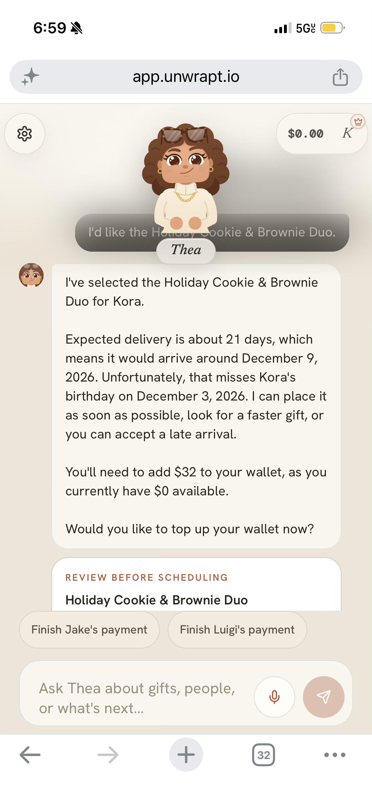

## What happened
After selecting a gift, the Review before scheduling card is clipped by the payment chip row below the chat; the chat does not scroll to show it.

## Expected / desired
The Review card is fully visible with its confirm actions after a gift is selected; payment chips don't hide it.

## Message context
```text
Reporter's note (with screenshot): Review card 'Holiday Cookie & Brownie Duo' is cut off; only its title is visible above the 'Finish Jake's payment / Finish Luigi's payment' chips, so the confirm actions can't be seen without scrolling.
```

## Screenshots


## Notes / fix log
- 2026-11-19 fixed: Chat force-scrolls to the bottom (re-pinned at 0/150/400/900ms) whenever a reply ends in a Review or gift cards, and payment chips are hidden while a Review card is the latest message. Not verified on a device; needs someone else to verify.
