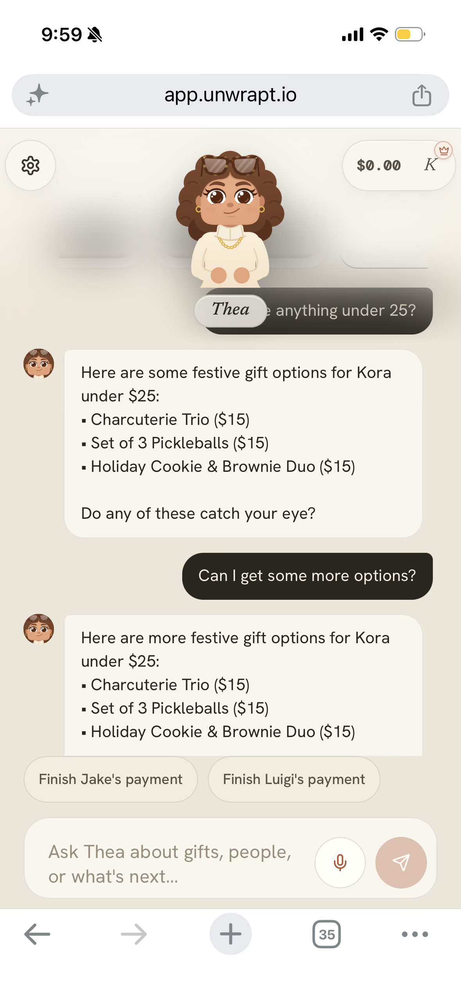

## What happened
Asking 'Can I get some more options?' returned the same three gifts again.

## Expected / desired
More options means new items; say so when few are left.

## Message context
(none attached)

## Screenshots

## Notes / fix log
- 2026-11-19 fixed: Fixed in PR #88; awaiting verification by someone else.
